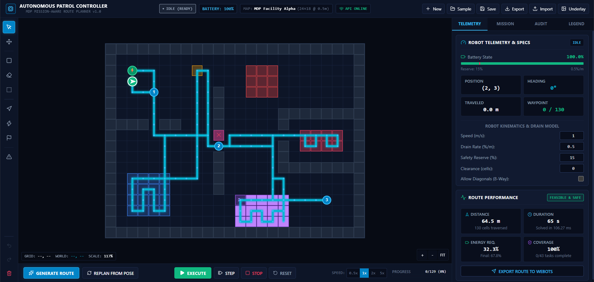

# MDP Mission-Aware Autonomous Patrol Route Planner

A complete, production-grade mission-control dashboard and autonomous route-planning engine built for a multidisciplinary college project (MDP) single-robot surveillance, scouting, and patrol platform.



---

## 1. Executive Summary & Capabilities

The **MDP Autonomous Patrol Route Planner** provides end-to-end mission planning, multi-objective patrol optimization, battery feasibility enforcement, obstacle-aware pathfinding, live execution simulation, and an integration boundary for future Webots robotics deployment.

### Key Capabilities:
- **Interactive Grid Map Editor**: Real-time canvas editing supporting walls, restricted zones, standard patrol zones, high-priority inspection areas, extra-patrol zones, temporary blockages, checkpoints, robot start pose, charging dock, and optional floor-plan image underlays.
- **Pure-Python Planning Engine**: Obstacle-aware A* pathfinding supporting both 4-way orthogonal and 8-way diagonal traversal with strict corner-cutting prevention and safety clearance inflation.
- **Mission & Patrol Optimization**: Priority-weighted sequencing of checkpoints and patrol zones, multi-visit extra-patrol scheduling, and one-time target completion tracking.
- **Energy & Battery Feasibility**: Configurable linear battery drain model, safety reserve margins, and guaranteed return-to-dock routing before battery exhaustion.
- **Interactive Simulation Engine**: State-machine execution (start, pause, resume, step, reset, stop, variable speeds `0.5x`–`5x`) with live battery consumption, telemetry tracking, and dynamic in-flight replanning upon encountering temporary obstacles.
- **Webots Robotics Integration Adapter**: Language-neutral JSON route export and metric coordinate transformations mapping grid coordinates to physical Cartesian world meters.

---

## 2. Technology Stack

- **Frontend**:
  - React 19 & TypeScript (strict type checking, `verbatimModuleSyntax`)
  - Vite 8.3
  - Interactive HTML5 Canvas grid renderer (smooth cursor-centered zoom, panning, drag-selection)
  - Lucide React iconography
  - Vitest & React Testing Library
- **Backend**:
  - Python 3.14 (Virtual Environment)
  - FastAPI & Pydantic v2
  - Uvicorn ASGI Server
  - Pytest & Ruff
- **Architecture**: Clean decoupled separation between pure-Python pathfinding/mission algorithms, RESTful API layer, and frontend UI.

---

## 3. Quick Start & Local Execution

### Prerequisites
- Python 3.11+ (Python 3.14 recommended)
- Node.js 18+ and npm

### One-Command Launch (PowerShell)
```powershell
.\scripts\run_dev.ps1
```
This automatically starts both the FastAPI backend (`http://127.0.0.1:8000`) and the Vite frontend (`http://localhost:5173`).

---

### Manual Setup & Execution

#### 1. Backend Setup
```powershell
# Navigate to project root
cd d:\WebDev\RoutePlannerV1

# Create and activate virtual environment
py -3.14 -m venv .venv
.\.venv\Scripts\Activate.ps1

# Install dependencies
pip install -r backend\requirements.txt

# Start backend server
cd backend
python -m uvicorn main:app --host 127.0.0.1 --port 8000 --reload
```
- API Root: `http://127.0.0.1:8000`
- Swagger Interactive API Docs: `http://127.0.0.1:8000/docs`

#### 2. Frontend Setup
```powershell
cd d:\WebDev\RoutePlannerV1\frontend

# Install dependencies
npm install

# Start Vite development server
npm run dev
```
- Open browser at: `http://localhost:5173`

---

## 4. Testing & Code Quality

Run all automated verification suites with one script:
```powershell
.\scripts\run_tests.ps1
```

### Running Backend Tests & Linting
```powershell
# Run Pytest (39 passing unit & integration tests)
.\.venv\Scripts\python.exe -m pytest -v backend\tests

# Run Ruff Code Quality Linter
.\.venv\Scripts\python.exe -m ruff check backend
```

### Running Frontend Tests & Production Build
```powershell
cd frontend
# Run Vitest component & store tests
npm test

# Run strict TypeScript build
npm run build
```

---

## 5. Planning Engine & Algorithm Architecture

### A* Pathfinding (`app/planner/astar.py`)
- **State Representation**: Node `(x, y)` on a 2D integer grid.
- **Cost Function**:
  $$f(n) = g(n) + h(n)$$
  where:
  - $g(n)$: Exact path cost from start to node $n$. Orthogonal movement cost = $1.0$, diagonal movement cost = $\sqrt{2} \approx 1.4142$.
  - $h(n)$: Admissible heuristic. Octile distance when diagonal movements are enabled:
    $$h(n) = \min(\Delta x, \Delta y) \cdot \sqrt{2} + |\Delta x - \Delta y|$$
    Manhattan distance when diagonals are disabled:
    $$h(n) = |\Delta x| + |\Delta y|$$
- **Diagonal Corner-Cutting Prevention**: When evaluating a diagonal step from $(x, y)$ to $(x \pm 1, y \pm 1)$, the step is strictly rejected if either adjacent orthogonal neighbor $(x \pm 1, y)$ or $(x, y \pm 1)$ is occupied by a wall, restricted zone, or temporary blockage.
- **Clearance Cost Inflation**: Nodes adjacent to physical obstacles receive an additive clearance penalty, steering the robot away from tight corners when open corridors exist.

### Independent Path Validator (`app/planner/validator.py`)
Before any route is returned or executed, it must pass an independent validator that verifies:
1. Start and destination matches exact requested coordinates.
2. Every waypoint $(x, y)$ lies strictly within map boundaries $0 \le x < W$ and $0 \le y < H$.
3. No waypoint intersects a wall, restricted zone, or active blockage.
4. Consecutive waypoints represent valid step transitions (orthogonal or legal diagonal, no teleportation).

### Mission & Patrol Optimization (`app/planner/patrol_planner.py`)
- **Task Extraction**: Checkpoints and traversable cells within patrol zones are extracted into mission targets:
  - High-priority inspection targets (Default weight = 8)
  - Standard patrol targets (Default weight = 4)
  - Extra-patrol targets (Default weight = 5, required visits = 2+)
  - Low-priority targets (Default weight = 2)
  - Checkpoints (Default weight = 10, sequential or priority-ordered)
- **Heuristic Sequencing**: Sequences legs greedily by balancing priority reward against travel distance and battery drain:
  $$\text{Score}(T) = \frac{\text{Priority}(T)}{\text{Distance}(P_{\text{curr}}, P_T) + \epsilon}$$
- **Battery Reserve & Return-to-Dock Constraint**: Before committing each leg, the engine projects the return path from the candidate target back to the charging dock. If remaining battery minus return cost falls below the safety reserve threshold (e.g., 15%), the planner commits an immediate return leg to the dock and marks subsequent targets as skipped due to battery infeasibility.

---

## 6. Battery & Energy Model (`app/planner/energy_model.py`)

- **Drain Rate**: Default linear travel drain $c_{\text{drain}} = 0.5\% \text{ per meter}$.
- **Leg Energy Consumption**:
  $$E_{\text{leg}} = d_{\text{leg}} \times c_{\text{drain}}$$
  where $d_{\text{leg}} = \text{waypoints count} \times \text{cell resolution (meters)}$.
- **Safety Reserve**: Default $R = 15\%$.
- **Return Feasibility Check**:
  $$\text{Battery}_{\text{projected}} - E_{\text{return\_to\_dock}} \ge R$$
- **Recharging**: When docked at the charging station, the robot battery replenishes at a configurable rate (default $2.0\% \text{ per simulation tick}$).

---

## 7. Interactive Simulation & Dynamic Replanning

- **Simulation States**: `IDLE`, `PLANNING`, `PATROLLING`, `PAUSED`, `OBSTACLE_DETECTED`, `RETURNING_TO_DOCK`, `DOCKED_CHARGING`, `COMPLETED`, `BATTERY_DEPLETED`.
- **Dynamic Replanning**:
  1. If a temporary blockage is placed directly on the remaining route, the simulation pauses and flags `OBSTACLE_DETECTED`.
  2. Clicking **REPLAN FROM POSE** or triggering `/api/simulation/replan` invokes the planner using the robot's current pose $(x, y, \theta)$ as the new start point, accounting for newly blocked cells and uncompleted targets.

---

## 8. Webots Robotics Integration Contract (`app/adapters/webots_contract.py`)

The planning engine is decoupled from Webots via a language-neutral contract. The Webots supervisor or robot controller can be implemented in Python, C, or C++ without modifying the planner.

### Coordinate Conversion Formulas
Grid coordinates $(x, y)$ map to physical Webots world meters $(X_w, Y_w)$:
$$X_w = \left(x - \frac{W}{2} + 0.5\right) \times \text{resolution}$$
$$Y_w = \left(y - \frac{H}{2} + 0.5\right) \times \text{resolution}$$

Inverse mapping from Webots world sensor coordinates back to grid:
$$x = \left\lfloor \frac{X_w}{\text{resolution}} + \frac{W}{2} \right\rfloor$$
$$y = \left\lfloor \frac{Y_w}{\text{resolution}} + \frac{H}{2} \right\rfloor$$

### Exported Route Format (`/api/adapters/webots/export-route`)
```json
{
  "mission_id": "mission_alpha_1",
  "generated_at": 1728734000.0,
  "map_name": "MDP Facility Alpha",
  "resolution_meters": 0.5,
  "total_distance_meters": 64.5,
  "estimated_duration_seconds": 129.0,
  "waypoints": [
    {
      "step_index": 0,
      "grid_x": 2,
      "grid_y": 3,
      "world_x_m": -4.75,
      "world_y_m": -2.75,
      "target_speed_mps": 0.5,
      "action": "none"
    },
    {
      "step_index": 1,
      "grid_x": 3,
      "grid_y": 3,
      "world_x_m": -4.25,
      "world_y_m": -2.75,
      "target_speed_mps": 0.5,
      "action": "inspect_checkpoint"
    }
  ]
}
```

### Future Webots Python Supervisor Example
```python
from controller import Supervisor
import requests, json

supervisor = Supervisor()
robot_node = supervisor.getFromDef("PATROL_ROBOT")
trans_field = robot_node.getField("translation")

# Fetch planned route from planner API
response = requests.get("http://127.0.0.1:8000/api/adapters/webots/export-route")
route_data = response.json()

for wp in route_data["waypoints"]:
    target_x = wp["world_x_m"]
    target_z = wp["world_y_m"]
    # Command robot motors or supervisor translation
```

---

## 9. API Reference

| Endpoint | Method | Description |
|---|---|---|
| `/api/health` | `GET` | Health check and engine status |
| `/api/maps/sample` | `GET` | Fetch default MDP Facility Alpha map |
| `/api/maps/save` | `POST` | Save map to server storage |
| `/api/maps/load/{name}` | `GET` | Load saved map |
| `/api/plan/mission` | `POST` | Generate full mission route plan |
| `/api/plan/path` | `POST` | Compute single point-to-point A* path |
| `/api/simulation/state` | `GET` | Get current simulation state |
| `/api/simulation/start` | `POST` | Start simulation execution |
| `/api/simulation/pause` | `POST` | Pause running simulation |
| `/api/simulation/resume` | `POST` | Resume paused simulation |
| `/api/simulation/step` | `POST` | Execute single simulation step |
| `/api/simulation/stop` | `POST` | Stop and abort simulation |
| `/api/simulation/reset` | `POST` | Reset simulation to initial start pose |
| `/api/simulation/replan` | `POST` | Dynamic replanning from current robot pose |
| `/api/adapters/webots/export-route` | `POST` | Export route formatted for Webots controllers |

---

## 10. License & Academic Attribution
Developed as part of the Multidisciplinary College Engineering Project (MDP) for Autonomous Patrol Robotics.
Academic and research use permitted.
